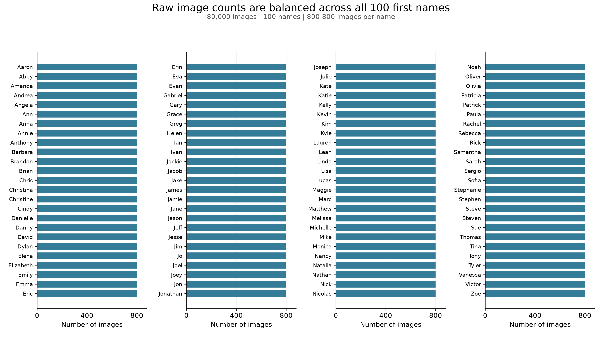
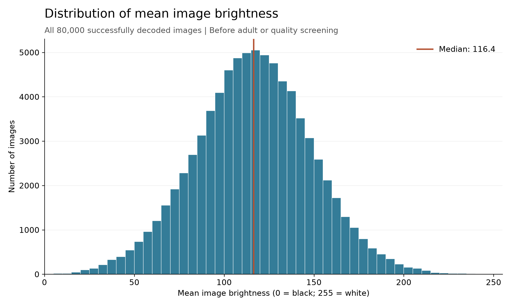

# Dataset documentation

## Access

Obtain the Names100 archive from https://purl.stanford.edu/tp945cq9122 [3].
The author's dataset page is https://huizhongchen.github.io/datasets.html.
Keep the original `Names100Dataset.tar.gz` in `DATA/raw/` locally, or supply
its external path to the scripts. Images and archives are excluded from Git.
The current local source is `C:\Users\annie\Downloads\Names100Dataset.tar.gz`.
The archive contains `Names100Dataset/Names100_Images/`, `README`, and
`names100.txt`. No prepared adult subset is included yet.

## Data summary

The raw dataset contains 80,000 PNG images across 100 first names, with 800
images per name [3]. Local inspection confirmed 120-pixel width, 150-pixel
height, and three 8-bit RGB channels. All 80,000 images decoded successfully
during exploratory analysis. Adult eligibility, image quality, label correctness,
and repeated individuals remain unresolved. Final counts will be reported
after screening.

## Provenance

Chen, Gallagher, and Girod collected Flickr images using first names selected
from U.S. Social Security Administration popularity statistics [3]. They
required a single detected face and a single first-name tag, filtered tags
matching 4,717 celebrity names, and limited downloads to one image per Flickr
user. Incorrect labels and repeated people may remain. These are automatically
collected name tags, not independently verified identities or ages.

## License and use terms

The repository's use and reproduction statement, supplied from the Stanford
record in the team's MI2 documentation, prohibits using content, where applicable,
to identify individuals or infringe privacy or confidentiality rights. Additional
depositor restrictions may apply [3]. A named dataset license and unrestricted
redistribution permission have not been verified. Link to the original source
rather than distributing the image archive. The project's MIT license does not
apply to the underlying photographs or third-party model weights.

## Ethical considerations

Names can correlate with demographic and cultural factors. Predictive performance
does not establish that names cause facial appearance or that social groups have
inherent biological characteristics. Automated ages are estimates, not verified
dates of birth. Report estimated-adult screening and its limitations explicitly.
Do not use the project to identify people or publish individual-level predictions.

## Data dictionary

| Field/component | Type | Meaning and uncertainty |
|---|---|---|
| filename | Text | `name_imageNumber.png`; original image identifier. |
| first_name | Category | Filename-derived Flickr name tag; 100 categories before screening; unverified. |
| image_number | Integer | Within-name image number; not a unique person identifier. |
| image_pixels | Numeric array | 150 rows x 120 columns x 3 RGB channels, 0-255 before preprocessing. |
| width | Integer | 120 pixels in inspected raw image headers. |
| height | Integer | 150 pixels in inspected raw image headers. |
| color_channels | RGB | Three channels at 8 bits per channel. |

Verified ages, unique person identifiers, and quality annotations are not
supplied in the documented raw structure. A screening manifest will record
derived fields and exclusion reasons when implemented.

## Exploratory plots

**Plot 1: Number of Images per First Name.** This bar chart shows image counts
across all 100 name categories [3]. Each contains exactly 800 images, confirming
raw class balance. Adult and quality screening may change this balance.

**Plot 2: Distribution of Mean Image Brightness.** This histogram describes
average weighted RGB brightness across all 80,000 images [3]. Most values are
moderate, with fewer very dark or very bright images. Median brightness is
116.4 out of 255. This explores overall brightness variation; it does not
establish whether an image contains a usable face.

## References

[3] H. Chen, A. Gallagher, and B. Girod, "What's in a name: First names as facial attributes," in *Proc. IEEE Conf. Comput. Vis. Pattern Recognit. (CVPR)*, 2013, pp. 3366-3373, doi: 10.1109/CVPR.2013.432. [Dataset]. Available: https://purl.stanford.edu/tp945cq9122
