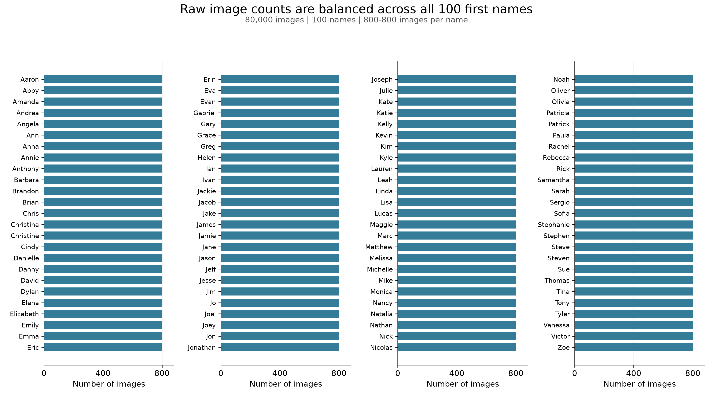
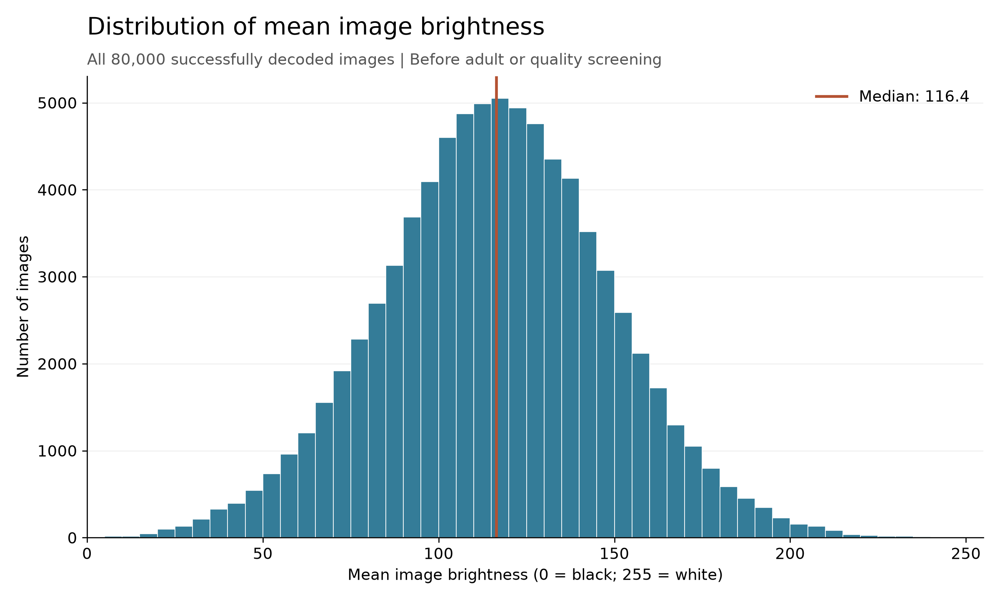

# Metadata

## Data Summary

The established Names100 dataset contains 80,000 facial images across 100 first-name categories, with exactly 800 images per name [3]. Inspection of the downloaded archive confirmed that each observation consists of a 120 × 150 pixel PNG image with three 8-bit RGB color channels and a first-name label encoded in the filename. The archive also includes a list of the name categories and documentation describing the dataset.

The raw data are balanced across names, although face-detection errors, incorrect name labels, repeated individuals, and age eligibility remain to be assessed during preprocessing. Final sample counts and category distributions will be documented after screening.

The dataset is currently stored locally in `Names100Dataset.tar.gz` and can be obtained through the Stanford repository listed in [3]. Our project repository will include code and instructions for obtaining and preparing the data.

## Provenance

The Names100 dataset was created by Huizhong Chen, Andrew Gallagher, and Bernd Girod for their 2013 study [3]. The researchers selected popular first names using U.S. Social Security Administration statistics and collected Flickr images using those names as search terms. Names were retained when at least 800 image examples were available.

Collection procedures required a single detected face and a single first name in the image tags, excluded tags matching 4,717 celebrity names, and limited downloads to one image per Flickr user. The authors acknowledge that incorrect name labels and repeated individuals may remain [3].

Our group obtained the dataset as the compressed archive `Names100Dataset.tar.gz`.

## License

The Names100 dataset is subject to the Stanford Digital Repository’s use and reproduction terms. These terms prohibit using the content, where applicable, to identify individuals or infringe their privacy or confidentiality rights, and note that additional depositor-imposed license and use restrictions may apply [3].

The quoted terms do not specify a named license or establish unrestricted redistribution rights. Our group will follow these conditions and verify any additional restrictions before redistributing image files. Our public project repository will provide code, documentation, and a link to the original dataset rather than a copy of the image archive.

## Data Dictionary

The dataset consists of image files. Each image represents one observation, with its first-name label and image identifier encoded in the filename. The following dictionary describes the documented structure [3] and our inspection of the downloaded archive.

| Feature Name | Data Type | Description | Notes |
|---|---|---|---|
| `filename` | Text | Original image filename, linking an image to its name category and image number. | Example: `Thomas_288.png`. |
| `first_name` | Categorical text; parsed from filename | Dataset-assigned first-name label used as the modeling target. | 100 categories listed in `names100.txt`; 800 images per category. Labels have not been independently verified. |
| `image_number` | Integer; parsed from filename | Numeric identifier following the name and underscore. | Example: `288`. Treat the combination of name and number as an image identifier; the number does not establish a person’s identity. |
| `image_pixels` | Three-dimensional array | Visual input to the model, decoded from the PNG file. | 150 rows × 120 columns × 3 RGB channels. Each channel value ranges from 0–255 before preprocessing. Images may contain detection errors. |
| `width` | Integer | Horizontal image dimension. | 120 pixels for all 80,000 image headers inspected. |
| `height` | Integer | Vertical image dimension. | 150 pixels for all 80,000 image headers inspected. |
| `color_channels` | RGB | Red, green, and blue channels representing image color. | Three channels, each stored at 8-bit depth. |

## Exploratory Plots

### Plot 1: Number of Images per First Name

This bar chart shows how images are distributed across the 100 first-name categories in the Names100 dataset [3]. Each name contains exactly 800 images, indicating that the raw dataset is balanced across categories. This plot helps us understand name representation before preprocessing, although removing images during adult and quality screening may change this balance.

### Plot 2: Distribution of Mean Image Brightness

This histogram shows how average image brightness is distributed across the 80,000 images in the Names100 dataset [3]. Most images are concentrated around moderate brightness levels, while fewer images have very low or very high average brightness. This plot helps us understand variation in image brightness before preprocessing and model training. However, average brightness alone does not establish whether an image contains a usable face or should be excluded.

## References

[3] H. Chen, A. Gallagher, and B. Girod, “What’s in a Name? First Names as Facial Attributes,” *Proceedings of the IEEE Conference on Computer Vision and Pattern Recognition (CVPR)*, 2013. [Dataset: Stanford Digital Repository](https://purl.stanford.edu/tp945cq9122).